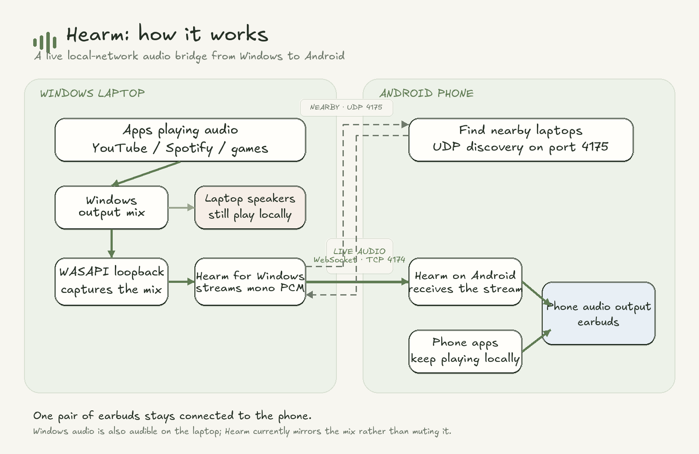

<p align="center">
  
</p>

<p align="center">
  <strong>Windows audio in your Android earbuds.</strong><br />
  Stream the laptop's output mix to your phone over Wi-Fi.
</p>

<p align="center">Made by ashyy &lt;3</p>

## How it works

Laptop audio is captured once and mirrored to Android. Phone apps keep playing locally, so both sources reach the phone's audio output.



## Quick start

1. Install the [.NET 11 SDK](https://dotnet.microsoft.com/en-us/download/dotnet/11.0).
2. In PowerShell, run the Windows sender:

   ```powershell
   dotnet run --project .\windows\Hearm.Windows.csproj
   ```

3. Install Hearm on Android using the ready [APK](Hearm-android.apk), or connect the phone by USB and run `powershell -ExecutionPolicy Bypass -File .\install-android.ps1`.
4. Put both devices on the same Wi-Fi. Click **Start sharing laptop audio** on Windows, then tap **Find nearby laptops** in the Android app and choose your laptop.

If discovery doesn’t find the laptop, enter the address and pairing code shown in the Windows app. Allow Hearm through Windows Firewall on private networks if prompted.

<details>
<summary><strong>Technology</strong></summary>

| Area | Technology | Role |
| --- | --- | --- |
| Windows app | .NET 11, WPF, NAudio | Captures the Windows output mix with WASAPI loopback |
| Windows network | ASP.NET Core WebSocket, UDP | Streams audio and answers nearby-device scans |
| Android app | Java, Android SDK, AudioTrack | Plays incoming PCM audio through the phone output |
| Android network | OkHttp WebSocket, DatagramSocket | Receives audio and discovers the Windows sender |
| Diagram | Excalifont | Hand-drawn project flow image |

</details>

<details>
<summary><strong>Network and audio details</strong></summary>

| Flow | Transport | Port | Direction |
| --- | --- | ---: | --- |
| Nearby discovery | UDP broadcast / reply | 4175 | Android ↔ Windows |
| Audio | WebSocket over TCP | 4174 | Windows → Android |
| Audio format | 16-bit signed, mono PCM | — | Windows → Android |

Audio stays on your local network; Hearm has no cloud relay. The connection uses unencrypted `ws://`, so use a trusted Wi-Fi network.

</details>

<details>
<summary><strong>Requirements and limitations</strong></summary>

| Requirement | Details |
| --- | --- |
| Windows | Windows 10 or newer; .NET 11 SDK |
| Android | Android 8.0 (API 26) or newer |
| Build Android | JDK 21 and Android SDK at `%LOCALAPPDATA%\Android\Sdk` |
| Network | Same Wi-Fi; guest networks or client isolation can block discovery |
| Phone playback | Keep Hearm in the foreground; background playback isn’t implemented yet |

- Windows keeps playing audio locally while Hearm mirrors it to Android. Lowering Windows volume may also lower the captured stream.
- Phone apps play locally and are not sent back to Windows.
- Some apps or protected content may prevent Windows capture.
- If nearby scan finds nothing, check the Windows private-network firewall setting and use manual pairing.

</details>

<details>
<summary><strong>Project files</strong></summary>

| Path | Contents |
| --- | --- |
| `windows/` | Windows sender and loopback capture |
| `android/` | Android receiver, nearby scan, and app icon |
| `docs/images/` | Hearm logo and Excalifont architecture image |
| `docs/assets/` | Excalifont source font and license notice |
| `install-android.ps1` | Builds the APK; installs it if a USB-debugging phone is connected |
| `LICENSE` | MIT License |

</details>

## License

[MIT](LICENSE) © 2026 ashyy.
